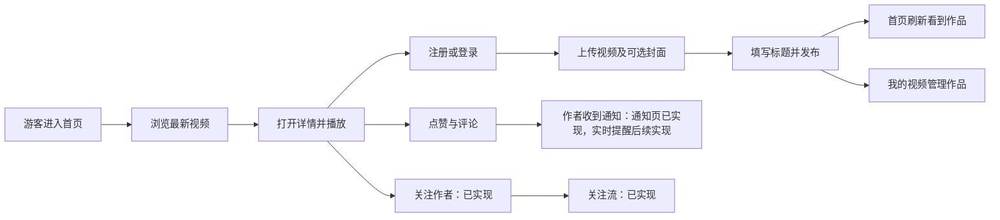
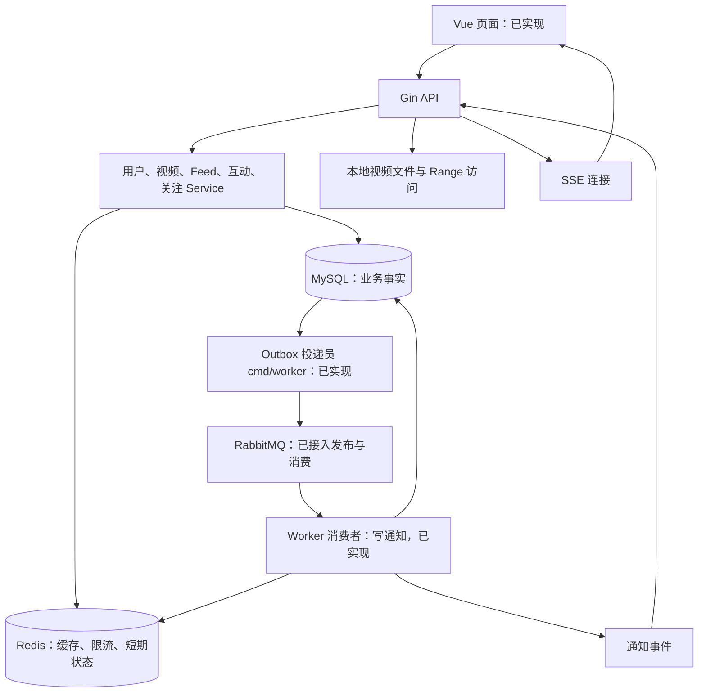

# GoStream：项目主线与分阶段开发计划

本文用于跟踪系统模块、阶段进度和后续学习步骤。
设计基线日期：2026-10-29；盘点更新：2026-11-02。事实依据为当前仓库源码和验收记录；待开发项不代表已经完成。最新参考源码核对和优先级见 [差距与模块盘点](11_reference_gap_review.md)。

## 1. 我们到底在做什么

目标产品：一个能够注册登录、发布短视频、浏览播放、互动和关注的视频社区。
目标岗位：Go 后端开发实习。重点是能独立解释并实现请求处理、数据建模、事务、缓存和异步任务。
目标技术栈：参考 feedsystem_video_go，逐步具备 Gin、GORM、MySQL、Redis、RabbitMQ、JWT、YAML/env、API/Worker、SSE、Vue/TypeScript、Docker Compose、CI、健康检查和 pprof 的实际使用链路。

现在已经在正式开发项目。剩余问题是功能整合和技术栈演进，不是等待另起一个正式项目。
不推倒当前代码，不因为目录没有完全统一而重新开始。

## 2. 先看完整用户流程

发布者与观看者是同一种用户在不同场景下的角色，不单独建立两套账号。
“上传成功”只表示文件和上传记录保存成功；“发布成功”才创建 videos 中的作品。
当前没有管理员审核；uploads.status 是文件生命周期状态，不能当成内容审核状态。

## 3. 目前到底完成了多少

| 能力 | 源码位置 | 当前状态 | 仍需做什么 |
| --- | --- | --- | --- |
| 注册、登录、当前用户 | internal/user、internal/auth | 已实现，已分层，有测试 | 后续补完整输入约束；当前退出只是清除页面 token |
| 视频/封面上传 | internal/video/handler.go、cover.go、storage.go | 已实现、本地文件保存 | 后续收敛为独立上传服务；当前不是对象存储 |
| 发布、归属和事务 | internal/video/handler.go 的 Publish | 已实现上传归属检查、锁和状态更新 | 部分逻辑仍在 Handler，按发布功能演进时再提取 |
| 列表、详情、我的视频、作者删除 | internal/video/handler.go | API 和页面已有 | 删除作品不等于立即回收物理文件 |
| 最新 Feed | internal/feed、cmd/server/main.go、frontend/src/stores/library.ts | 后端、Vue 页面、自动测试和浏览器验收已完成；索引迁移及 EXPLAIN 已验证 | 后续缓存；关注流已在 M2 完成；没有性能提升数值结论 |
| 点赞、评论 | internal/video/like*、comment* | 分层、接口、页面、Feed 批量信息和双账号验收已完成；新增的点赞、评论与发件箱事件同一事务提交（M4 第一步），由 worker 发到 RabbitMQ（第二步）并写成作者的通知（第三步），作者在通知页查看（第四步） | 实时提醒在 M4 第五步 |
| 过期上传清理 | cmd/cleanup-uploads、upload_cleanup* | 已有手动命令和测试 | 未自动调度，不重复重写 |
| 页面 | frontend/src、frontend/tests、web/dist 构建产物 | Vue/TS/Pinia/Router/Vite 迁移完成，Chromium 夹具与真实双账号测试通过 | 未做全面浏览器兼容性验收 |
| 关注关系 | internal/follow、scripts/migrations/006_follows.sql | 关注/取消/状态 API 已完成，含单元、HTTP、真实 MySQL 集成与端到端测试；详情页关注按钮与关注流（GET /feed/following、关注标签页）已通过夹具与真实浏览器验收 | 粉丝列表/计数可后续扩展 |
| 视频详情缓存 | internal/video/video_{repository,cache,local_cache,service}.go、cmd/server/main.go | Redis Cache-Aside、删除后失效、Redis 故障降级；go-cache 5 秒本地缓存、singleflight 合并回源、30 秒“不存在”标记、发布后清标记均已完成，miniredis、MySQL 端到端与真实 Redis 验证通过 | — |
| 最新流时间线 | internal/feed/timeline.go、service.go、internal/video/handler.go、cmd/server/main.go | Redis 时间线缓存最新 500 条（ZSET 存补零 ID 与毫秒发布时间、HASH 存公开字段、底部哨兵 end/more），发布/删除后整条失效、读时 singleflight 重建，超出窗口或故障回源 MySQL；miniredis、与无缓存路径逐页对比的 MySQL 端到端、真实 Redis 与隔离 Compose 浏览器验收通过 | 发布时增量更新、关注流 |
| 限流 | internal/ratelimit/limiter.go、middleware.go、cmd/server/main.go | 固定窗口计数（MULTI 里 INCR + EXPIRE NX + PTTL）；登录、注册按 IP，写操作按用户共用额度；超限 429 + Retry-After；Redis 故障降级为单机计数；miniredis、单机并发计数、路由限额与 Redis 停机测试、真实 Redis 与隔离 Compose 浏览器验收通过 | 滑动窗口或令牌桶、按账号限流、熔断 |
| 事件发件箱与投递员 | internal/outbox、internal/mq、cmd/worker、scripts/migrations/007_outbox_events.sql | 点赞、评论事件与业务数据同一事务写入 outbox_events，只存 ID；独立 worker 用 FOR UPDATE SKIP LOCKED 领取，RabbitMQ 确认后才标记，失败退避重试，已发送 7 天后分批删除；真实 MySQL、RabbitMQ 集成与隔离 Compose 验收通过 | — |
| 通知消费者 | internal/notification、internal/mq/consumer.go、cmd/worker、scripts/migrations/008_notifications.sql | worker 的第二个任务把通知队列里的事件写成 notifications（唯一键按接收者和事件 ID 去重，视频删除时级联删除），数据库提交后 ACK；无效事件拒绝进死信，数据库错误原地退避重试、不退回队列；单元、真实 MySQL 与 RabbitMQ 集成、端到端和变异测试通过 | — |
| 通知列表与已读 | internal/notification/handler.go 等、scripts/migrations/009_notifications_unread_index.sql、frontend/src/views/NotificationsView.vue、stores/notifications.ts | GET /notifications（id 倒序游标、JOIN 带出展示字段）、未读数（(recipient_id, read_at) 覆盖索引，EXPLAIN 已验证）、单条已读（幂等，别人的和不存在的都 404）、全部已读（只到 up_to）；侧栏未读数（60 秒轮询）与通知页；单元、真实 MySQL、HTTP 端到端、前端单元与夹具、真实浏览器和变异测试通过 | SSE 实时提醒（M4 第五步） |
| RabbitMQ、SSE | internal/mq、compose.yaml 的 rabbitmq 与 worker 服务 | amqp091-go 发布端与消费端已接入（发布确认、mandatory、仲裁队列、手动确认、死信队列）；SSE 未实现 | M4 第五步 |
| 配置/部署/观测 | internal/config、internal/health、Dockerfile、compose.yaml、.github/workflows/ci.yml | 配置、健康检查、镜像、SIGTERM、Compose 持久化及 Vue 部署完成；基础 CI 已在 GitHub Actions 运行通过 | pprof 待完成 |

“有源码/有测试”不等于当前浏览器进程正在运行最新版本。实际验收方式及覆盖边界见 [M0 验收记录](07_m0_acceptance.md)；没有进行压测。

## 4. 技术架构的方向

先保持一个模块化 Go 应用；API 和 Worker 是两个可独立运行的进程，不因此拆成多个业务微服务。

推荐算法暂不实现。最新流是一种明确的排序策略，未来推荐流有自己的候选来源和游标；复用详情组装，不共用时间查询条件。

## 5. 模块边界

| 模块 | 用户看见的功能 | 后端主要职责 | 当前/计划 |
| --- | --- | --- | --- |
| 用户与认证 | 注册、登录、我的账号 | 密码哈希、身份验证、token | 已有，逐步补边界 |
| 上传与媒体 | 选择文件、上传、播放 | 类型/大小校验、文件保存、归属、上传生命周期 | 已有；分片续传后续加入 |
| 视频作品 | 发布、详情、我的作品、删除 | 作品记录、发布事务、写权限 | 已有 |
| Feed | 首页加载更多、刷新 | 内容顺序、分页、批量组装、以后缓存/降级 | 后端及页面已有并验收 |
| 互动 | 点赞、评论、删除本人评论 | 唯一约束、幂等、内容校验、计数 | 已有 |
| 关注 | 关注/取消、关注流 | 有向关系、自关注检查、按关系筛选 | 已实现：关系 API、关注按钮、关注流 |
| 通知 | 收到点赞/评论/关注提醒 | 事件处理、持久化、未读、SSE | 进行中：点赞、评论事件写成通知，通知列表、未读数和已读已实现；SSE 待开发 |
| 行为与推荐扩展 | 曝光、播放等 | 事件定义、去重、推荐组件边界 | 延后，不训练模型 |
| 工程基础 | 环境启动、错误排查、部署 | 配置、依赖连接、观测、迁移、CI | 部分已有 |

每个模块的接口、表、依赖和失败行为见 [模块设计](04_module_design.md)。

## 6. 固定里程碑：一次只做一个

### M0：把当前产品接成完整流程（完成）

目标：从页面完成“登录 → 发布 → 首页看到 → 播放 → 互动 → 我的作品管理”。

| 任务 | 操作 | 完成证据 |
| --- | --- | --- |
| M0-1（完成） | 将公共视频列表接到 /feed；使用加载更多、刷新；我的视频保留原页码分页 | 自动回归通过；真实浏览器 6+1 条追加、末尾停止、刷新和个人分页切换通过 |
| M0-2（完成） | 增加 (created_at,id) 索引迁移、同步新库 schema | 隔离迁移/EXPLAIN 通过；用户已提供业务库执行成功及小表计划输出；无性能提升数值结论 |
| M0-3（代码和测试完成） | Feed 批量补充作者信息、点赞数和当前用户状态 | 普通测试、MySQL/HTTP 验证非空 3 次读取，游客/A/B 个人状态正确；真实浏览器验收并入 M0-4 |
| M0-4（核心流程完成） | 用账号 A/B 验收完整场景，保存操作步骤 | 真实 HTTP/MySQL、双账号页面发布/互动/个人状态及多批加载通过；删除确认由 HTTP 测试覆盖，见 07_m0_acceptance.md |
| M0-5（完成） | 整理本阶段改动、文档与提交 | 验收记录和复现方法已保存；2026-11-02 随阶段提交 cdf4a69 入库，不含密钥和上传文件 |

M0 不迁移 Vue，不接 MQ，不继续扩展游标加密形式，不改写全部旧 Handler。
优先 M0-1 是为了先让学习者能看见整个流程；索引仍在本里程碑内完成，不是永远推迟。

### M1：开发与展示环境统一（完成）

目标：参考技术栈开始真正进入项目，而不是只有依赖名称。

- 配置统一入口：YAML 保存非敏感默认项，env 覆盖；密码和签名密钥只来自环境或本地忽略文件。
- Compose 编排 API、MySQL、Redis、RabbitMQ，使用可配置端口避免与现有 MySQL 冲突；不自动迁移/覆盖现有本地业务库。
- 先增加存活检查和就绪检查、配置缺失时明确报错、优雅退出；先小范围，再接完整部署。
- 将现有界面迁到 Vue 3 + TypeScript + Pinia + Vue Router + Vite，页面功能不丢失；由导师承担前端实现。
- 整理可复现的阶段提交和远端，建立基础 CI（Go 检查、前端类型检查/构建）；M6 再扩展性能与故障验证。
- 验收：在新的隔离环境按 README 启动，完成 M0 场景；前端构建与类型检查通过。

Redis/MQ 在 Compose 中能启动，只算环境就绪，不算业务接入完成。

### M2：关注关系与关注流（完成）

目标：用户能关注作者，并只在关注流看到关注作者的作品。

- 设计 follows 表和唯一键；完成关注/取消/状态查询；增加关注流。
- 页面添加作者入口和关注流入口，不做复杂个人主页。
- 验收：A 关注 B 后可见 B 的视频；取消后新查询不可见；重复操作幂等；不能关注自己。
- 学习重点：关系表、联合唯一键、接口幂等、EXISTS/JOIN、鉴权与目标 ID 的不同来源。
- 进度（2026-11-03）：M2 完成。follows 表（006 迁移）、关注/取消/状态 API、详情页关注按钮、关注流 GET /feed/following 与视频库关注标签页均已实现；单元、HTTP、真实 MySQL 集成、端到端、Chromium 夹具与隔离 Compose 真实浏览器验收通过。

### M3：Redis 在真实读链路中发挥作用（完成）

目标：Feed 读性能与重复请求治理具有可验证的缓存方案。

- 先实现公开视频实体的 Cache-Aside：批量读取、未命中回源、写入缓存、发布/删除后的失效策略。
- 再实现最近时间线缓存，保持最新流的组合排序语义；更旧数据明确回源 MySQL。
- 加短时本地缓存和 singleflight；分别测命中、未命中、并发回源与失效后的行为，不宣称分布式 singleflight。
- 登录/写接口限流，明确 Redis 故障时的策略；个性化状态不能污染公共缓存。
- 明确 access/refresh 凭证、服务端撤销及过期规则，按需扩展认证状态。
- 验收：命中减少数据库访问；Redis 不可用时降级符合约定；删除作品不因旧缓存继续泄漏展示。
- 缓存一致性说明必须包含 TTL 与失效窗口，而不是“设置 Redis 后就强一致”。
- 进度（2026-11-04）：第一步完成。GET /videos/:id 使用 Redis Cache-Aside（key gostream:video:v1:{id}，TTL 10 分钟加 0～60 秒抖动），删除先删库再删缓存，Redis 故障降级到 MySQL；单元、miniredis、MySQL 端到端、gostream-dev 真实 Redis 与隔离 Compose 浏览器验收通过。下一步：本地缓存与 singleflight、空值缓存。
- 进度（2026-11-05）：第二步完成。Redis 前加 go-cache 5 秒本地缓存（多实例最多陈旧 5 秒）；singleflight 合并单进程内同一 ID 的并发回源，共享查询不随第一个调用方取消，并有 3 秒超时；MySQL 确认不存在时写 30 秒标记防穿透，发布事务提交后清除；Redis 客户端建连也不重试。单元、synctest 并发、MySQL 端到端（两个实例共享 Redis）、gostream-dev 真实 Redis 与隔离 Compose 浏览器验收通过。下一步：时间线缓存。
- 进度（2026-11-06）：第三步完成。最新流先读 Redis 时间线：有序集合按毫秒发布时间存补零到 20 位的视频 ID（同一毫秒按 ID 倒序，与 MySQL 组合排序一致），哈希存公开字段，只保存最新 500 条，底部哨兵区分“到底了”和“更早的回 MySQL”；续读取“同一毫秒且 ID 更小”加“更早”的两段，不用时间减 1；作者名与点赞信息仍每次查 MySQL。发布、删除后整条失效，读时 singleflight 重建（读 501 行），1 分钟过期兜底并发重建写回旧列表的窗口。单元、synctest 并发、与无缓存路径逐页对比的 MySQL 端到端、gostream-dev 真实 Redis（换镜像前后首页逐字节一致）与隔离 Compose 浏览器验收通过。下一步：限流。
- 进度（2026-11-10）：第四步完成。新增 internal/ratelimit：固定窗口计数在同一个 MULTI 里执行 INCR、EXPIRE … NX、PTTL，窗口从第一次请求开始，被拒绝的请求不延长窗口，也不会留下没有过期时间的计数器；登录每个 IP 每分钟 10 次、注册每个 IP 每小时 10 个、写操作每个用户每分钟共 60 次，超限返回 429 + Retry-After（向上取整）；Redis 故障时 FailoverLimiter 降级为 go-cache 单机计数，未配置 Redis 时只用单机计数；规则无效启动即 panic，写操作缺少用户 ID 返回 500。单元、单机并发计数、两种装配下的路由限额与 Redis 停机测试、gostream-dev 真实 Redis（第 11 次登录返回 429，计数器 TTL 59 秒，验证后已删除）与隔离 Compose 浏览器验收通过。下一步：认证刷新与撤销。
- 进度（2026-11-11）：第五步完成，M3 完成。access token 改为 15 分钟并带会话 ID（sid）；refresh token（会话ID.密钥）放在 HttpOnly、SameSite=Strict、Path=/auth 的 Cookie 里，Redis 哈希只存密钥的 SHA-256，7 天滑动过期；每次刷新用 Lua 脚本原子轮换，已换掉的旧 token 再出现就删除整个会话；鉴权中间件每个请求用 EXISTS 确认会话还在，退出后已签发的 access token 立刻失效；Redis 故障时中间件按签名放行（最多 15 分钟），登录和刷新返回 503；未配置 Redis 时会话存在本进程内存；刷新接口每个 IP 每分钟 30 次。前端刷新页面时用 Cookie 恢复登录，过期前 1 分钟自动刷新，401 时刷新并重发一次，同一时刻只发一个刷新请求，退出调用服务端接口。两种会话存储共用的单元测试（20 个并发刷新只成功 1 个）、中间件与 Handler 测试、两种装配下的 MySQL 端到端、前端单元与 UI 测试、gostream-dev 真实 Redis（只发不带账号和密码的请求，验证后删除刷新计数器）与隔离 Compose 浏览器验收（刷新页面保持登录、退出后旧 access token 立刻 401）通过。下一步：M4 异步事件、Worker 与通知。

### M4：异步事件、Worker 与通知

目标：用户互动成功后，作者可以收到通知，失败和重试有明确规则。

- 保留点赞/评论的同步 MySQL 业务结果；不为使用 MQ 立即改成异步业务落库。
- 业务变更与 outbox 事件在同一事务提交；Worker 发布 RabbitMQ 消息。
- 消费者按事件 ID 幂等地写通知；提交成功再 ACK，失败重试，毒消息隔离。
- 通知落库后通过受鉴权的 SSE 推送提示；断线后以通知列表补读，SSE 不承担唯一存储职责。
- 验收：MQ 停机不丢已提交事件，恢复后补发；重复投递不重复通知；非本人不能订阅别人的提醒。
- 计划（2026-11-12）：拆成五步——发件箱；投递员（cmd/worker，发件箱 → RabbitMQ）；消费者（幂等写通知、ACK、重试、死信）；通知列表接口与页面；SSE 提醒。只通知点赞和评论，自己的视频不通知。
- 进度（2026-11-12）：第一步完成。新表 outbox_events（007 迁移），id 即事件 ID，published_at 为 NULL 表示待发送；点赞、评论在 GORM 事务里先 INSERT … SELECT、再查作者、最后写 like.created / comment.created 事件（只存 ID），任何一步失败整体回滚；重复点赞、自己的视频、不存在的视频不产生事件。事务假驱动单元测试、真实 MySQL 集成（schema 与迁移一致、并发重复点赞只留一个事件、发件箱不可用时整体回滚）、gostream-dev 执行 007 并换新镜像、隔离 Compose 浏览器验收通过。下一步：投递员。
- 进度（2026-11-13）：第二步完成。新增独立进程 cmd/worker（Compose 的 worker 服务，复用 API 镜像，只需要 DSN 和 AMQP 地址）：投递员在读已提交事务里用 SELECT … FOR UPDATE SKIP LOCKED 按 id 领取最多 100 条待发事件，经 internal/mq 发到 topic 交换机 gostream.events（持久消息，message_id 为事件 ID，routing key 为事件类型），RabbitMQ 确认收到、且没有因无队列接收被退回时才写 published_at；失败等待 1、2、4… 秒（最多 30 秒），成功后恢复每秒一次，满批立即再领；每小时分批删除发出满 7 天的事件。仲裁队列 gostream.notifications 绑定 like.created、comment.created，最多投递 5 次，超过或被拒绝的进死信队列。投递是至少一次：确认后、标记前出错会重发，由消费者按事件 ID 去重。单元（synctest 虚拟时钟检查退避与清理）、真实 MySQL（SKIP LOCKED、只标记确认的事件、可重复读下新事件写入会被挡住而读已提交不会）与 RabbitMQ 集成、连不上 RabbitMQ 时事件留在发件箱且换回正确地址后全部送达的端到端、变异测试、gostream-dev 换新镜像并启动 worker（已有的 4 条事件已发出）、隔离 Compose 浏览器验收（第二个账号点赞后消息进入通知队列，重建后仍在）通过。下一步：消费者。
- 进度（2026-11-14）：第三步完成。新表 notifications（008 迁移）：唯一键 (recipient_id, event_id) 去重，视频删除时级联删除，删评论不撤回通知，created_at 存事件发生的时间，read_at 留给第四步。worker 的第二个任务从通知队列取消息：internal/notification 把事件转换成通知，用 INSERT … SELECT … FROM videos 写入（视频已删不写、1062 算重复投递、1452 算无效事件）；internal/mq 的消费者 prefetch 10、处理完再 ACK，无效事件拒绝进死信，数据库错误原地退避重试、不退回队列（退回一次就计一次投递）。实测 RabbitMQ 4.2：没确认就断开连接、带重新入队的拒绝都计一次投递，最多投递 6 次后进死信。单元（假驱动、假应答、synctest）、真实 MySQL、真实 RabbitMQ、worker 端到端、60 处变异、gostream-dev 执行 008 并换新镜像（排队一天半的 4 条消息变成作者 1 的 4 条通知，时间仍是当初点赞、评论的时间）、隔离 Compose 浏览器验收（worker 停止期间的评论在重启后变成通知）通过。下一步：通知列表接口与页面。
- 进度（2026-11-14）：第四步完成。接口 GET /notifications（id 倒序、普通 id 游标、多查一条判断下一页、一条 SQL 用 JOIN 带出用户名和标题、LEFT JOIN 带出评论内容）、GET /notifications/unread-count、PUT /notifications/:id/read（幂等，别人的和不存在的都 404）、PUT /notifications/read?up_to=（全部已读只到页面上最新那条）；接收者只取自 JWT，每条 SQL 都带 recipient_id。009 迁移给未读数加 (recipient_id, read_at) 覆盖索引，EXPLAIN 确认只读索引。前端侧栏“通知”带未读数（60 秒轮询），通知页可翻页、点开标记已读、全部已读；手机导航改成两行。四个业务文件由用户编写，测试抓到 5 处问题（参数多逗号、ParseInt、少 .Error、SQL 少空格、多包一层 data）后改正。单元、真实 MySQL 与 EXPLAIN、HTTP 端到端、前端单元与夹具、45 处变异、gostream-dev 执行 009 并换新镜像、隔离 Compose 真实浏览器验收（第二个账号点赞、评论后作者在通知页收到并标记已读）通过。下一步：SSE 实时提醒。

### M5：上传增强与恢复能力

目标：在已有普通上传之外，实现可恢复的大文件上传链路。

- 分片会话由服务端创建并绑定用户，Redis 管会话短期状态，本地目录保存分片。
- 实现初始化、上传分片、查询进度、合并；前端用 spark-md5 计算摘要时，不把摘要当作权限凭证。
- 合并成功仍进入现有 uploads pending → Publish → published 流程。
- 覆盖重复分片、越权、超限、过期和中断重试；使用已有清理机制思想处理遗留分片。
- 不在本阶段引入参考栈没有明确要求的对象存储或转码集群。

### M6：工程交付与面试证据

- 扩展 M1 的基础 CI：Go 测试/vet、前端类型检查/构建、隔离环境集成测试；明确哪些测试依赖外部服务。
- 请求 ID 与结构化日志、关键耗时/失败率指标；pprof 只在受控调试入口开放。
- 选 Feed 命中/未命中场景测延迟、错误率、数据库查询次数；报告环境、数据量、并发和测量方法。
- 故障演练：Redis/MQ 中断、Worker 重启、请求取消、SSE 断开；留下真实结果和限制。
- 整理启动说明、架构图、演示流程和 Git 提交；只用已实现、已验证的事实写项目经历。

## 7. 技术栈对齐清单

| 参考技术/能力 | GoStream 现状 | 进入阶段 | 实际用途 |
| --- | --- | --- | --- |
| Gin / GORM / MySQL / JWT / bcrypt | 已使用 | 当前 | API、数据、认证 |
| YAML / env | API/清理命令已接入加载、覆盖和校验 | M1 | 统一配置与部署覆盖 |
| Vue 3 / TS / Pinia / Router / Vite | 已迁移并通过真实浏览器验收，Vite 8 原生 Rolldown | M1 | 可维护的展示和验收客户端 |
| Docker Compose | 五服务编排（M4 第二步加入 worker）和持久化重建测试通过 | M1 | 隔离且可复现的环境 |
| go-redis / Redis | 视频详情 Cache-Aside、最新流时间线与限流计数已使用（go-redis v9），测试用 miniredis | M3 | 缓存、时间线、限流、后续上传会话 |
| go-cache / singleflight | 视频详情已使用：go-cache 5 秒本地缓存，x/sync singleflight 合并单进程内的回源 | M3 | 短时本地缓存和进程内回源合并 |
| amqp091-go / RabbitMQ / Worker | cmd/worker 投递员用 amqp091-go 发布点赞、评论事件（M4 第二步），消费者把它们写成通知（第三步） | M4 | 可靠异步通知与后续事件处理 |
| SSE | 未实现 | M4 | 通知即时提示与重连补读 |
| 分片上传 / spark-md5 | 未实现 | M5 | 上传恢复与前端分片能力 |
| CI / health / pprof | 健康检查已回归；基础 CI 已在 GitHub Actions 运行通过；pprof 待实现 | M1/M6 | 可运行、可回归、可定位 |

对齐的是技术的有效使用与故障处理，不强制复制依赖补丁版本、全部接口或私聊/推荐模型。
参考依赖依据 backend/go.mod、frontend/package.json 和根目录 docker-compose.yml、.github/workflows/ci.yml。

## 8. 以后每次怎么学、怎么做

每次开工先说明：当前里程碑、当前任务、用户能看到什么、改动范围、完成标准。
固定步骤：

1. 用一个实际请求讲清输入、输出和数据流。
2. 先确定接口、表和权限；有并发时明确事务或唯一约束。
3. 给你一小块业务实现任务，说明在哪个文件、调用谁。
4. 导师编写并执行测试，反馈可核实的结果；失败只定位当前范围。
5. 接通页面或可操作的请求，验收成功与一个关键失败路径。
6. 记录本次完成项与剩余项，完成里程碑后统一整理提交。

你：业务规则、Service/Repository 的练习实现与解释。
导师：测试、前端、通用技术工具、配置装配和代码审查；你明确要求直接修改时再接手对应业务实现。
不要求你写完所有测试后才推进，也不让你一次复制整个系统。

## 9. 已完成任务卡：M0-1

用户目标：在首页浏览最新视频，点击“加载更多”继续，点击“刷新”看到最新发布作品。

- 已有：GET /feed、签名游标、后端各层和测试。
- 修改范围：web/app.js、web/index.html，必要的样式与前端回归测试。
- 公共流：维护 videos、nextCursor、hasMore、loading、error 和请求序号。
- 初次/刷新：清空旧游标，替换列表；加载更多：携带游标，追加列表。
- 我的作品：保持 GET /me/videos 的页码分页；两种模式的分页状态不能混用。
- 重复点击不能并行追加；刷新或切换模式后，旧响应不能污染新列表。
- 游标失效提示刷新；网络失败保留已有内容和可重试位置，不直接跳过一批。
- 发布成功后回到公共流并刷新；发布本身不改为由 Feed 执行。

完成标准：用户不用手动复制游标，就能在页面完成两批加载、末尾停止、刷新和切换我的视频。
M0-1 实施记录：公共页面已使用 /feed，新增加载更多、刷新重置、失败重试与请求序号隔离；发布成功返回公共流刷新；我的作品保留原分页。模拟 DOM/API 专项测试、原有发布/点赞/评论测试和 go test ./... 通过。

2026-11-01 已补真实浏览器验收：隔离环境 7 条作品验证 6+1 条追加、末尾停止、刷新、我的视频切换；页面上传发布和双账号互动另有独立记录。详见 07_m0_acceptance.md，不把模拟 DOM 测试当作完整浏览器验证。

M1 配置、健康检查、默认 SIGTERM、镜像、Compose 持久化和 Vue 技术栈迁移均已验收。Vue 真实双账号测试覆盖发布播放、互动、越权和 6+1 分页；2026-11-02 阶段提交 cdf4a69 已推送到 GitHub，CI 首次运行（GoStream checks #1）的 backend、frontend 均通过，M1 完成。M2 关注关系与关注流已完成；M3（缓存、限流、登录凭证的刷新与撤销）已完成。进度和边界见 [配置管理](08_config_management.md)、[健康检查](09_health_checks.md)、[容器第一步](10_container_basics.md)、[差距盘点](11_reference_gap_review.md)、[Compose 环境](12_compose_environment.md)、[Vue 迁移](13_vue_migration.md)。M4 已完成发件箱、投递员、通知消费者和通知列表（worker 用 amqp091-go 把点赞、评论事件发到 RabbitMQ，再写成作者的通知，作者在通知页查看和标记已读），SSE 待做；Redis 已接入视频详情与最新流缓存、限流计数和登录会话。

## 10. 本轮依据与边界

- 本地：cmd/server/main.go、internal/user、internal/auth、internal/video、internal/feed、scripts/schema.sql、web/app.js。
- [参考后端依赖](https://github.com/LeoninCS/feedsystem_video_go/blob/main/backend/go.mod)
- [参考前端依赖](https://github.com/LeoninCS/feedsystem_video_go/blob/main/frontend/package.json)
- [参考项目](https://github.com/LeoninCS/feedsystem_video_go)

初版仅阅读源码和保存设计；此后按里程碑实施。最新实现和验收记录见 05/06/07 文档，不能把初版的只读范围当成后续全部工作的描述。
版本、性能结果、用户规模与上线状态均不从依赖名称推断。
