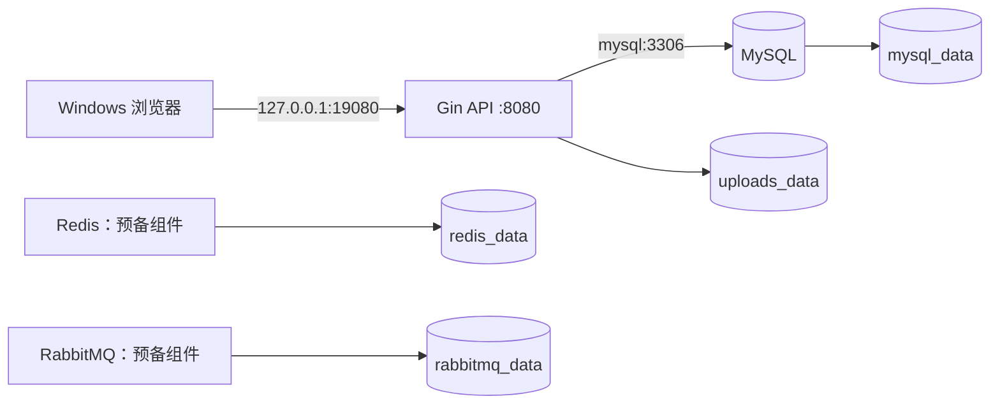

# M1：Compose 开发环境

状态（2026-11-02）：四服务、SIGTERM、隔离重建及持久化测试已通过；后续 Vue 迁移与真实浏览器验收也已完成，见 [迁移记录](13_vue_migration.md)。Redis/RabbitMQ 仅完成环境准备。阶段提交已推送到 GitHub，基础 CI 首次运行通过。

本机 `gostream-dev` 开发栈已启动，四服务均 healthy；首页返回 200，`/healthz` 和 `/readyz` 均返回 ok。使用全新的开发卷，没有导入原 Windows MySQL 数据。原停止状态的 redis 容器和原本机配置保留。

## 1. 这一轮解决什么问题

以前需要分别准备数据库、启动 Go 服务，并手工确认它们使用同一组配置。现在通过根目录 `compose.yaml` 描述 API、MySQL、Redis、RabbitMQ、端口、健康检查和数据卷，让开发环境可以重复启动。

Dockerfile 负责“怎样构建 API 镜像”；Compose 负责“怎样把这些容器组合运行”。当前仍是一个 Go API 进程，增加容器不等于拆分业务微服务。



图中没有 API 到 Redis/MQ 的业务箭头，因为当前源码还没有相应 Client 和读写调用。之后在 M3/M4 接入。

## 2. 首次启动与日常使用

在项目根目录打开 PowerShell，Docker Desktop 保持运行：

```powershell
./scripts/init-compose-env.ps1
docker compose --env-file .env.compose config --quiet
docker compose --env-file .env.compose up -d --build --wait --wait-timeout 180
docker compose --env-file .env.compose ps
```

初始化脚本生成本机 `.env.compose`，各项密码和签名密钥分别使用密码学随机源生成；文件存在时保留原设置。它已被 Git 排除，公开模板是 `.env.compose.example`。普通本机运行继续用 `.env`；两套运行方式使用不同数据库、密钥和上传目录。

`--env-file` 提供 Compose 的变量替换值，`environment` 再逐项注入容器；它不是把文件里的所有变量自动交给 Go。进程中已有的同名变量可能覆盖文件值，排查时先确认变量来源。不要把包含真实密钥的完整 `docker compose config` 输出贴到公开位置；校验语法使用 `config --quiet`。

| 用途 | Windows 访问地址 | Compose 网络内地址 |
| --- | --- | --- |
| 页面及 API | http://127.0.0.1:19080/ | api:8080 |
| MySQL | 127.0.0.1:13307 | mysql:3306 |
| Redis | 127.0.0.1:16379 | redis:6379 |
| RabbitMQ AMQP | 127.0.0.1:15673 | rabbitmq:5672 |
| RabbitMQ 管理页面 | http://127.0.0.1:15674/ | rabbitmq:15672 |

端口可在 `.env.compose` 修改。主机端口只绑定 127.0.0.1，用于本机学习。RabbitMQ 默认用户名是 `gostream`，密码在该文件的 `COMPOSE_RABBITMQ_PASSWORD`；MySQL 应用账号也是 `gostream`。

停止并保留容器：

```powershell
docker compose --env-file .env.compose stop
```

移除容器和项目网络，但保留命名数据卷：

```powershell
docker compose --env-file .env.compose down
```

再次使用 `up -d --wait` 启动。修改 Go 源码后使用前面的 `up -d --build --wait --wait-timeout 180` 重建 API；修改源码不会自动更新已经构建的镜像。

## 3. 为什么地址是 mysql:3306

`"127.0.0.1:13307:3306"` 表示“把 Windows 的 13307 转发到 MySQL 容器的 3306”。API 容器通过 Compose 网络中的服务名 `mysql` 找到 MySQL，直接使用容器端口 3306。

API 容器里的 `127.0.0.1` 是 API 容器自己，并不是 Windows，也不是 MySQL 容器。因此 Compose 给 Go 的 DSN 使用 `@tcp(mysql:3306)`，不能照搬本机运行的 `@tcp(127.0.0.1:13306)`。依据：[Compose 网络与服务名解析](https://docs.docker.com/compose/how-tos/networking/)。

## 4. 初始化与健康检查

新建 MySQL 数据卷第一次启动时，官方镜像执行只读挂载的 `scripts/schema.sql`，创建全部业务表（当前六张，含 006 新增的 follows）。复用已有数据库卷时不会重新执行初始化脚本；以后表结构改变仍需要显式执行迁移，不能只改 schema 后重启。

MySQL 健康检查使用应用账号连接数据库，并确认 users 表可查询。API 的 `depends_on: mysql: condition: service_healthy` 等待这个条件满足后启动；API 自身使用 `/readyz` 做健康检查。Redis 通过带密码的 PING 检查，RabbitMQ 检查节点运行状态。

API 当前只依赖 MySQL 的启动健康状态。Redis/MQ 还不是业务依赖，不应阻止 API 启动。`depends_on` 处理启动顺序；它不等于运行时自动修复，也不会因为容器变为 unhealthy 就自动重启它。`restart: unless-stopped` 处理进程退出后的重启。依据：[Compose 启动顺序](https://docs.docker.com/compose/how-tos/startup-order/)。

## 5. 数据为什么能保留

| 卷 | 挂载位置 | 保存什么 |
| --- | --- | --- |
| mysql_data | MySQL /var/lib/mysql | 账号、作品、上传记录、点赞、评论 |
| uploads_data | API /app/uploads | 视频和封面文件 |
| redis_data | Redis /data | 启用 AOF 后的数据 |
| rabbitmq_data | RabbitMQ /var/lib/rabbitmq | 节点、持久队列及消息等数据 |

默认项目名为 `gostream-dev`，实际卷名加此前缀，例如 `gostream-dev_mysql_data`。卷独立于容器生命周期；普通 `down` 后再 `up` 会复用。`down -v` 会删除本项目的数据卷，不是日常重启命令。修改项目名会选择另一组资源；持久化也不等于备份。依据：[Docker 数据卷](https://docs.docker.com/engine/storage/volumes/)。

API 以 UID/GID 10001 运行；镜像预先准备上传目录并授予权限，新命名卷初始化后已验证普通用户能上传。RabbitMQ 使用固定 hostname，避免重建时节点名变化导致数据目录不一致。持久化队列配合持久化消息才能验证消息跨重建保留，不能只挂载一个卷就认为所有消息必然可靠。

MySQL/RabbitMQ 初始化凭证主要在空数据目录时生效。已有卷后，只改 `.env.compose` 密码不等于修改数据库或 Broker 中已有账号的密码；应在服务内修改账号并同步应用配置。

## 6. 已执行的测试与边界

测试源码：`cmd/server/container_integration_test.go`、`cmd/server/compose_integration_test.go`。本轮 API 镜像为 `gostream-api:dev`，包含学习者已加入的 `syscall.SIGTERM`；默认 `docker stop` 退出码为 0。尚未模拟长时间请求的排空行为。

Compose 测试使用随机项目名、独立随机凭证、随机本机端口和独立卷，不读取 `.env` 或 `.env.compose`：

1. 四服务 healthy，首页与两个健康端点可访问。
2. 注册、登录、上传视频、发布作品和读取文件通过。
3. Redis 拒绝无密码请求，认证后可写入；RabbitMQ 可声明持久化交换机/队列并投递持久化消息。
4. 默认 SIGTERM 停止 API 正常退出，普通 down 后四个卷仍在。
5. 重建全部容器后，原 JWT/账号、作品记录、上传文件、Redis 值和 RabbitMQ 消息均保留。
6. 最终只删除本次测试项目的容器、网络和卷，开发环境数据不参与清理。

显式测试结果：`TestContainerAPIIntegration` PASS（约 25 秒），`TestComposeEnvironmentIntegration` PASS（约 48 秒）；`go test ./...`、`go vet ./...` 通过。时间仅为本机本轮运行记录，不是性能结论。

准备好四个本地镜像后可复现 Compose 测试：

```powershell
$env:GOSTREAM_COMPOSE_TEST = '1'
try {
    go test ./cmd/server -run '^TestComposeEnvironmentIntegration$' -count=1 -v -timeout=10m
} finally {
    Remove-Item Env:GOSTREAM_COMPOSE_TEST
}
```

普通测试默认跳过 Docker 测试。Compose 测试不自动构建或拉取镜像；先构建 `gostream-api:dev` 并准备 Compose 使用的 MySQL、Redis、RabbitMQ 镜像。测试使用 RabbitMQ 管理 HTTP API 作为环境探针，不代表 GoStream 已接入 AMQP。上传的是文件头识别测试字节，没有证明真实视频解码；播放能力沿用 M0 的实际浏览器验收，Compose 中可再上传真实 MP4 手动检查。

## 7. 下一步与阅读检查

Vue/TypeScript 迁移和基础 CI 配置已完成，见迁移记录；阶段提交、远端关联及 GitHub 首次 CI 运行也已于 2026-11-02 完成，M1 结束。下一项业务为 M2 关注模块，再在 M3/M4 加 Redis 和 MQ 的业务读写。

先尝试回答：API 为什么访问 mysql:3306，而你在 Windows 连接数据库却使用 127.0.0.1:13307？如果只删 API 容器，作品记录和视频文件分别靠什么保留？
