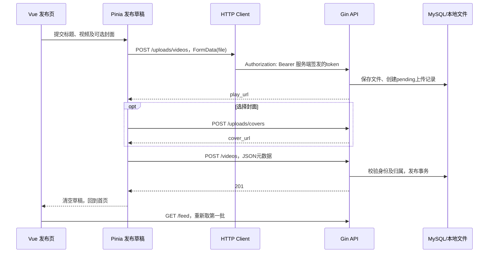

# M1：Vue 前端迁移与基础 CI

日期：2026-11-02。前端改为 Vue 3 + TypeScript + Pinia + Vue Router + Vite，保留现有后端业务接口。当前范围是页面、客户端状态、构建部署和测试，没有改动注册、发布、Feed、互动等 Service/Repository 业务规则。

## 1. 当前能完成的流程

游客浏览 Feed → 注册并自动登录 → 上传 MP4 及可选封面 → 发布 → 首页刷新 → 打开并播放 → 点赞评论 → 我的作品分页 → 作者删除。

新增了可直接进入的前端页面地址：

| 页面 | 地址 |
| --- | --- |
| 公共 Feed | http://127.0.0.1:19080/#/ |
| 我的视频 | http://127.0.0.1:19080/#/mine |
| 发布 | http://127.0.0.1:19080/#/publish |
| 当前账户 | http://127.0.0.1:19080/#/account |
| 视频详情 | http://127.0.0.1:19080/#/videos/实际ID |

`/#/videos/1` 是浏览器中的页面路由，`GET /videos/1` 是返回 JSON 的后端接口，`GET /media/videos/文件名.mp4` 才是视频字节请求。这三个地址职责不同。

## 2. 为什么拆成这些部分

```text
frontend/
├── src/
│   ├── api/client.ts          # fetch、JSON/FormData、204、HTTP 错误
│   ├── stores/
│   │   ├── session.ts         # 页面内存中的登录身份、会话版本、登录窗口
│   │   ├── library.ts         # 公共游标与个人页码分页，丢弃过时响应
│   │   └── publish.ts         # 上传草稿、上传结果复用、发布顺序
│   ├── components/           # 登录窗口、视频卡片、评论区
│   ├── views/                # 列表、发布、详情和账户页面
│   ├── router.ts             # Hash 页面路由及访客登录引导
│   ├── types.ts              # 现有接口的前端类型
│   ├── App.vue               # 工作台外壳和导航
│   └── main.ts               # Vue、Pinia、Router 装配
├── public/cover.svg           # 默认封面
├── tests/unit/               # 请求与状态机测试
├── tests/e2e/                # 浏览器响应夹具回归与真实双账号验收
├── tests/fixtures/playable.mp4 # 自行生成的可播放测试视频
├── package-lock.json         # 锁定依赖版本，用 npm ci 重现
└── vite.config.ts            # 本机 API 代理及构建目录
web/dist/                     # 构建结果，不提交 Git，由 Gin 提供
```

Vue 负责组件渲染，TypeScript 检查前端数据使用，Pinia 保存跨页面共享状态，Router 决定显示哪个页面，Vite 负责开发服务和构建。TypeScript 类型本身不会校验网络响应；Feed 分页字段、关键上传地址等仍显式检查。

参考项目的 vite 依赖指向 rolldown-vite 别名；本项目使用 Vite 8.3.5，其生产构建原生使用 Rolldown，覆盖同类构建能力，不为复刻旧别名降级。依据：[Vite 官方说明](https://vite.dev/guide/)。Vue 3.5.44、Pinia 3.0.4、Vue Router 4.6.4、TypeScript 5.9.3 等精确版本见 package.json/lock。

Hash 中的路径不会发给服务器，所以刷新详情页仍请求 `/`，未知 API 继续返回真实 404，不做把所有 404 都替换为首页的兜底。取舍是页面地址带 `#`，对当前本地工作台足够；以后需要更自然的网页地址时再协调前后端路径。依据：[Vue Router 路由模式](https://router.vuejs.org/guide/essentials/history-mode.html)。

## 3. 从页面到后端的一次请求



前端不发送 author_id 决定归属，身份仍由后端 JWT 中间件提取。前端隐藏删除按钮只是交互提示，实际写权限继续由后端控制。

登录 token 只在 Pinia 内存，刷新后重新登录，不写 localStorage/sessionStorage。JWTSecret 不进入前端源码、构建变量或页面。401 只清除发出该请求的当前会话；旧账号迟到的 401 不能退出新账号。

公共 Feed 和个人列表仍分别使用游标、page/page_size。请求序号与会话版本确保刷新、切换页面或账号后，旧响应不能覆盖新内容。追加失败保留视频和原游标；INVALID_CURSOR 要求刷新。评论与点赞也检查当前视频和会话，避免异步结果串到其他资源。

发布过程中阻止重复提交，暂时阻止页面内导航和退出；关闭浏览器由浏览器提示。发布失败后，同一会话中成功上传的视频/封面可以复用。更换文件清除对应上传结果，更换账号清空草稿；刷新页面不会恢复草稿。没有把普通上传伪装成分片续传。

## 4. 开发、构建与 Docker

在 frontend 目录执行：

```powershell
npm ci
npm run dev
```

页面为 http://127.0.0.1:5173/，Vite 将实际 API 路径代理到默认 http://127.0.0.1:19080/。因此先启动后端/Compose；仅打开 Vite 不会启动数据库。若后端本机监听 8080，可在同一个 PowerShell 设置 `$env:GOSTREAM_DEV_PROXY='http://127.0.0.1:8080'` 后启动 dev。

生产构建：`npm run build` 先执行 vue-tsc，再输出 web/dist。回到仓库根目录 `go run ./cmd/server`，Gin 的 `httpx.RegisterWeb` 提供首页、/assets 和 /cover.svg；默认媒体路由继续沿用原配置。首次本机运行需要先构建前端，API 本身不自动执行 npm。

Dockerfile 增加 Node 构建阶段，锁文件 npm ci 后构建前端；最终镜像只复制 Go 二进制、前端 dist、YAML 和运行依赖，不保留 Node、npm、前端源文件或 Go 工具链。Compose 地址仍为 19080，沿用原来的数据库和媒体卷。Docker 内不需要运行 Vite 开发服务器。

原 web/index.html/app.js/style.css 和 scripts/web_*_test.cjs 暂留为迁移前的学习对照，当前路由及镜像不再使用；新测试在 frontend/tests。后续阅读、修改页面请进入 frontend/src，不要改 dist 或旧 web/app.js。

## 5. 验证记录与边界

- 前端 12 项 Vitest 测试通过：请求编码、multipart boundary、204、错误码、会话隔离、分页、上传复用、重复提交和文件/标题边界。
- Chromium 6 项响应夹具页面测试通过：游标失败重试、受保护路由与登录、个人分页、发布复用、点赞评论、文本转义、401 与移动端导航。它们不证明真实数据库行为。
- 独立随机 Compose 项目中的真实 Chromium 双账号验收通过：注册自动登录、视频和 PNG 封面上传、发布、实际 MP4 解码播放、Range 206、点赞/评论/本人评论删除、跨账号越权拒绝、公共 6+1 分页、个人 6+1 分页、作者删除。没有使用开发库或原 Windows MySQL。
- Compose 普通 down/up 后账户、作品、文件、Redis 值和持久 MQ 消息保留测试通过，测试项目结束清理。
- Windows `go test ./...`、`go vet ./...`、入口构建和 Go 格式检查通过。Windows 当前 CGO_ENABLED=0；不把普通测试误称为 race 检测。
- Linux 容器 `docker build --target checks -t gostream-checks:dev .` 通过，实际执行 vet 与 `go test -race ./...`；镜像/容器 HTTP 停机恢复测试和默认 SIGTERM 再次通过。

真实 MP4 是浏览器生成的移动色块测试夹具，能证明本轮浏览器解码和推进播放时间，不代表所有用户视频格式、浏览器或编码均兼容。自动测试覆盖 Chromium；没有宣称 Safari/Firefox 全部验收。

复现命令见 [frontend/README.md](../../frontend/README.md)；Docker 容器测试需要先构建当前镜像。真实浏览器测试由 Compose 测试入口传入临时地址，默认 Playwright 命令不会对开发环境写入测试数据。

## 6. 基础 CI 与剩余工作

`.github/workflows/ci.yml` 在 push、pull_request 或手动触发时运行两组任务：

1. Go 格式、vet、race 测试及两个命令入口构建。
2. npm ci、前端单元测试、类型检查/构建、Chromium 响应夹具回归。

使用只读仓库权限，不配置本机数据库密码。依赖真实数据库/Docker 的测试继续显式开启；基础 CI 默认不连业务库。后续 M6 再扩展完整容器和故障测试，不把当前浏览器夹具测试说成线上验收。

2026-11-02 阶段提交 cdf4a69 已推送到 GitHub 远端 origin，GitHub Actions 首次运行（GoStream checks #1）的两组任务均通过。这说明格式、静态检查、单元与竞态测试、构建和 Chromium 夹具回归在干净的 Linux 环境中成立，不代表真实 MySQL、Compose 或线上验收。

下一项业务是 M2 关注关系：设计 follows 的有向关系与唯一键，再实现关注/取消、状态和关注流。你继续写业务，我负责测试和页面接入。

后续（2026-11-03）：详情页加入作者关注按钮。Chromium 夹具测试增至 8 项（新增关注交互、请求顺序与读取失败重试），`mockAPI` 默认应答关注接口，避免夹具测试访问网络；隔离 Compose 真实浏览器测试加入双账号关注、返回页面后状态保持、取消关注和作者本人不显示按钮。
